<div align="center">


# ASUS Control Center

**Battery, performance, GPU and display controls for ASUS laptops on Linux.**

[](https://github.com/Mostafamomen/asus-control-center/actions/workflows/packages.yml)
[](https://github.com/Mostafamomen/asus-control-center/releases/latest)
[](LICENSE)


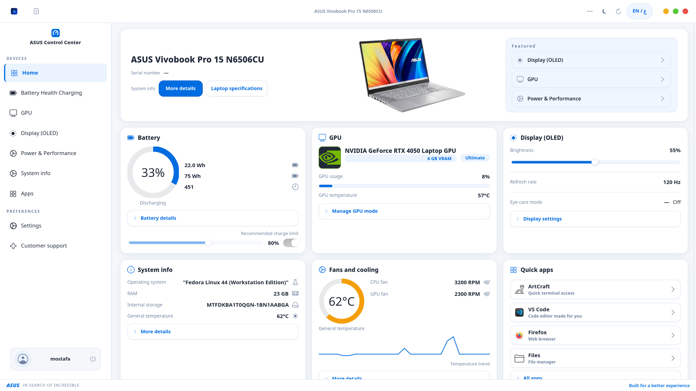

</div>

ASUS Control Center puts the hardware information and the controls your ASUS laptop's firmware exposes into one GTK 4 window, in the spirit of MyASUS on Windows. It is an independent open-source project and is **not affiliated with or endorsed by ASUS**.

## Features

- **Battery care:** charge limit (60 / 80 / 100 %) and charging mode where the embedded controller exposes them.
- **Performance:** Quiet, Balanced and Performance profiles, with live fan speed and temperatures.
- **GPU:** MUX switching (Hybrid / Ultimate) and iGPU-only mode through `supergfxctl`, plus NVIDIA telemetry.
- **Display:** hardware backlight, flicker-free OLED dimming below the panel's lowest level, eye-care and e-reading (greyscale) modes.
- **Keyboard and touchpad:** keyboard backlight level and touchpad on/off.
- **System info:** CPU, memory, storage, graphics, display, OS, BIOS and network at a glance.
- **Safe by design:** the app never runs as root. Hardware changes go through a small whitelist-only helper started with `pkexec`, so you are asked for your password and nothing else can be passed through. See [docs/security.md](docs/security.md).
- **English and Arabic**, light and dark styles.

Controls your laptop does not expose stay disabled instead of failing.

## Screenshots

| Light | Dark |
|---|---|
| 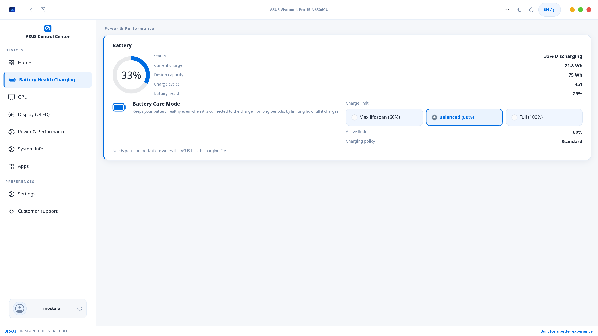 | 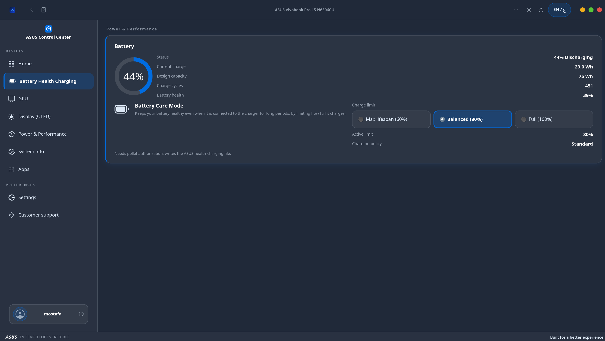 |
| 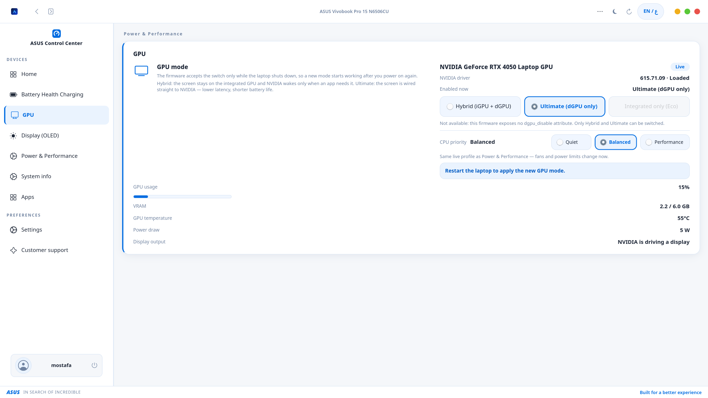 | 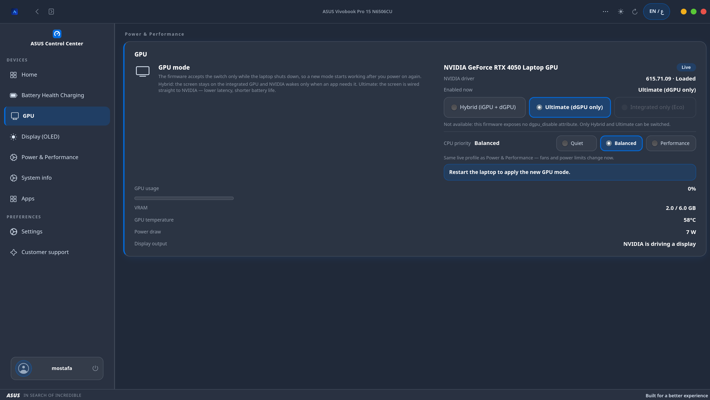 |
| 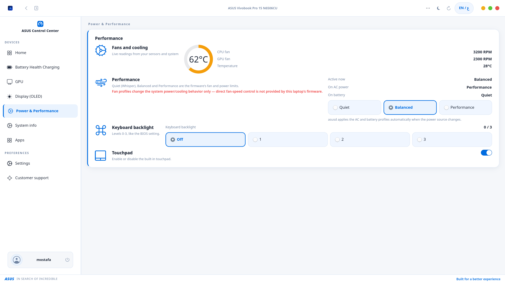 | 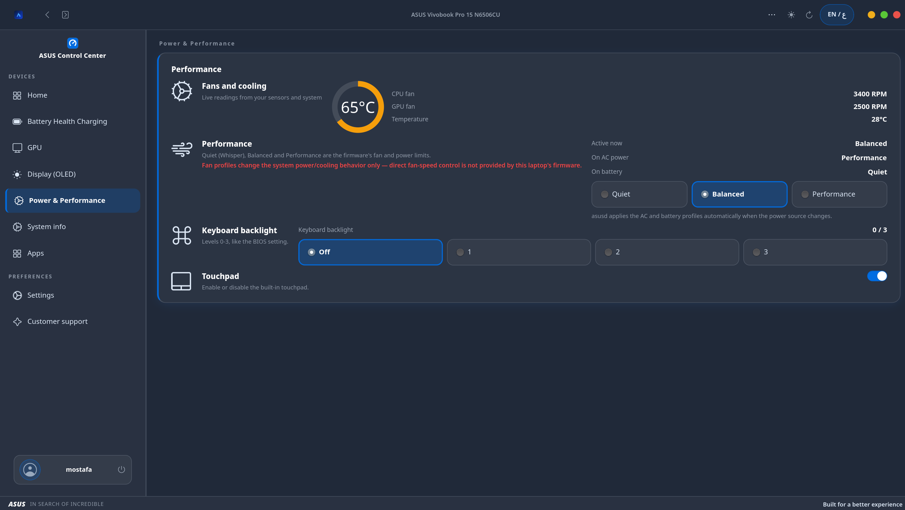 |
| 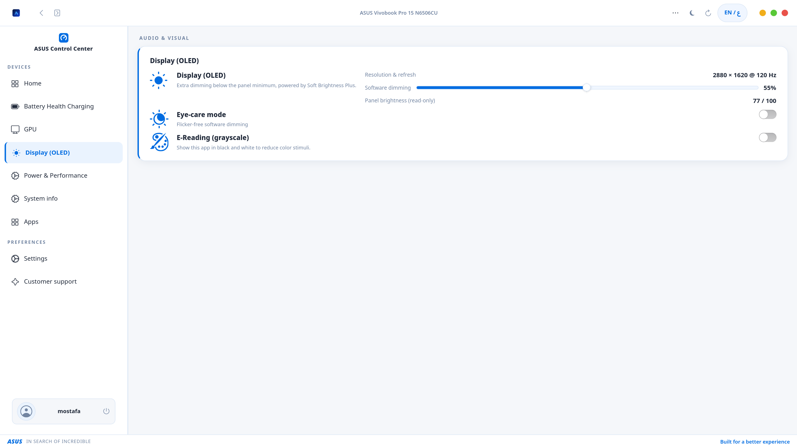 | 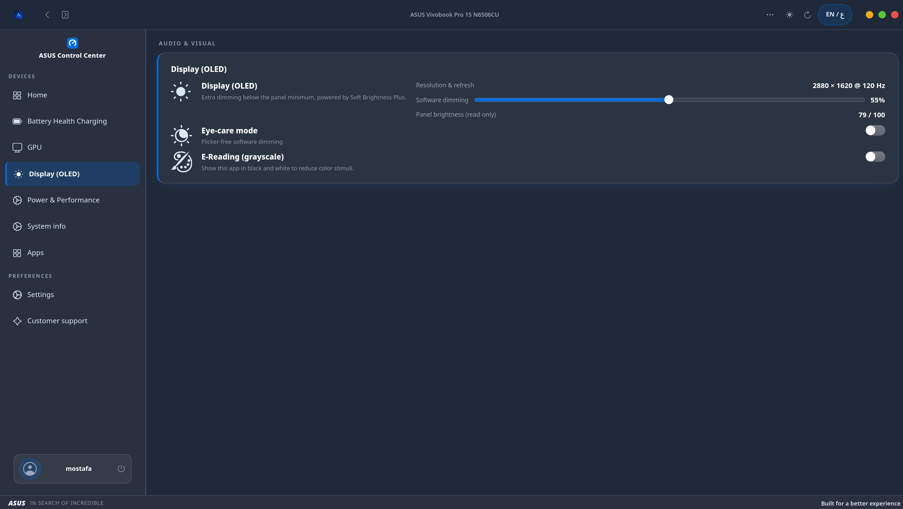 |
| 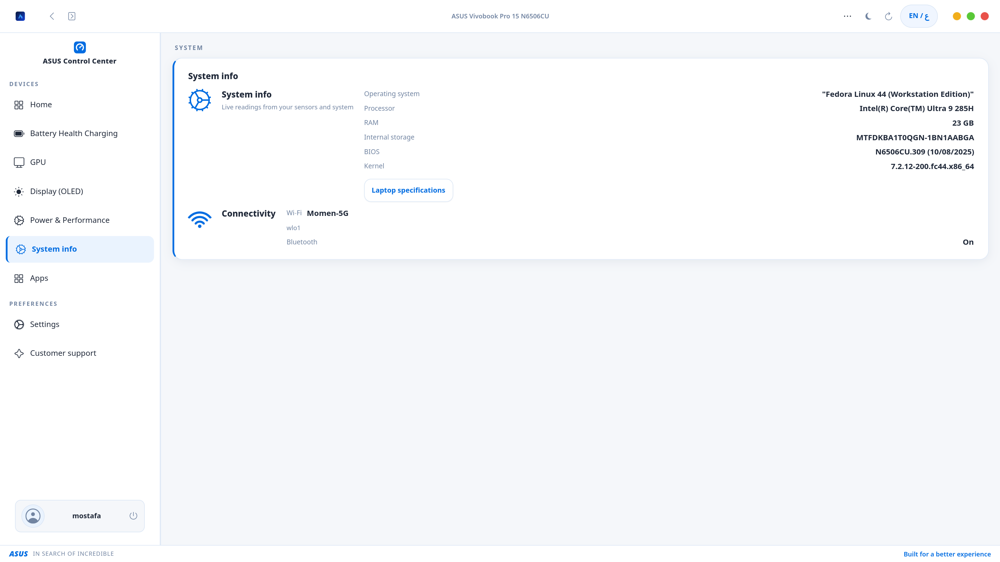 | 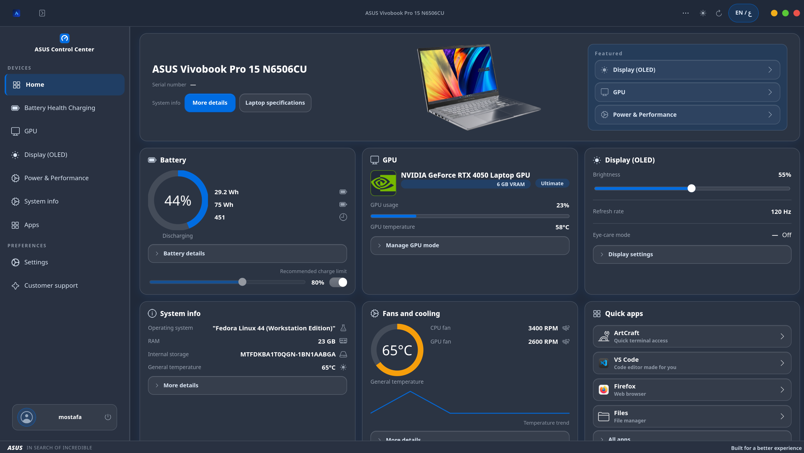 |

## Install

Download the package for your distribution from the [latest release](https://github.com/Mostafamomen/asus-control-center/releases/latest), then install it with your package manager so the dependencies come in automatically.

### Fedora, RHEL, AlmaLinux, Rocky Linux

```bash
# Fedora 41 or newer
sudo dnf install ./asus-control-center-*.fc*.x86_64.rpm

# RHEL / AlmaLinux / Rocky Linux 10 (needs EPEL)
sudo dnf install epel-release
sudo dnf install ./asus-control-center-*.el10.x86_64.rpm
```

### Ubuntu, Linux Mint, Zorin OS, Pop!_OS, elementary OS, Debian

```bash
sudo apt install ./asus-control-center_*_amd64.deb
```

Use `apt install ./file.deb` rather than `dpkg -i`, because apt fetches the dependencies for you. Mint and Zorin users can also double-click the file to open it in the package installer.

### Which versions work

The app needs **libadwaita 1.5 or newer**, which decides the oldest release it can run on.

| Distribution | Supported | Not supported (libadwaita too old) |
|---|---|---|
| Fedora | 41, 42, 43, 44 and newer | 39 and older |
| RHEL, AlmaLinux, Rocky | 10 | 9 and older |
| Ubuntu | 24.04 LTS, 25.04, 25.10 and newer | 22.04 LTS |
| Linux Mint | 22, 22.1, 22.2 and newer | 21.x |
| Zorin OS | 18 | 17 |
| Pop!_OS, elementary OS | 24.04 base (Pop!_OS 24.04, elementary 8) | 22.04 base |
| Debian | 13 (trixie) and newer | 12 (bookworm) |

### Optional: ASUS services

Most controls work through the kernel alone. Some need the [asus-linux](https://asus-linux.org) services, which the packages recommend but do not require:

- `asusd` (from `asusctl`): charging modes and keyboard lighting on many models.
- `supergfxd` (from `supergfxctl`): GPU MUX and iGPU-only mode.

On Fedora:

```bash
sudo dnf copr enable lukenukem/asus-linux
sudo dnf install asusctl supergfxctl
sudo systemctl enable --now supergfxd
```

On Ubuntu-based and Debian systems there is no official package; follow the [asus-linux guides](https://asus-linux.org/guides/) to build them. The app works without them and greys out the controls they provide.

### Uninstall

```bash
sudo dnf remove asus-control-center    # Fedora / RHEL family
sudo apt remove asus-control-center    # Ubuntu / Mint / Zorin / Debian
```

## Build from source

Install the build dependencies:

```bash
# Fedora
sudo dnf install gcc-c++ make pkgconfig gtk4-devel libadwaita-devel

# Ubuntu 24.04+, Mint 22+, Zorin 18, Debian 13+
sudo apt install build-essential pkgconf libgtk-4-dev libadwaita-1-dev
```

Then build, try it, and install:

```bash
git clone https://github.com/Mostafamomen/asus-control-center.git
cd asus-control-center
make
./asus-control-center            # run from the source tree
./asus-control-center --specs    # read-only hardware report
sudo make install                # installs under /usr, undo with: sudo make uninstall
```

If you only want to run from the source tree but still use the hardware controls, `./install.sh` installs just the helper and its polkit policy.

### Build the packages yourself

```bash
packaging/build-rpm.sh    # on Fedora or EL 10, writes dist/*.rpm
packaging/build-deb.sh    # on Ubuntu 24.04+ or Debian 13+, writes dist/*.deb
```

Run them with `sudo` the first time so they can install the build dependencies.

## Compatibility

The app detects what the running kernel and firmware expose, so what you see depends on the exact model, BIOS, kernel and installed services. The **ASUS Vivobook Pro 15 N6506CU** is the main development and test machine. Other models are expected to work to the degree listed below, until someone confirms them with a [compatibility report](https://github.com/Mostafamomen/asus-control-center/issues/new?template=compatibility.yml).

<details>
<summary><b>Full-support candidates</b>: dedicated GPU, often with a MUX</summary>

- **ROG Zephyrus:** G14 `GA403`, G16 `GU605`, M16 `GU604`, Duo 16 `GX650`, Flow X13 `GV302`, Flow X16 `GV601`
- **ROG Strix:** G16 `G614`, G18 `G814`, Scar 16 `G634`, Scar 18 `G834`, G17 `G713 / G714`, Scar 17 `G733 / G734`
- **TUF Gaming:** A14 `FA401`, A15 `FA506 / FA507`, A16 `FA607`, A17 `FA706 / FA707`, F15 `FX506 / FX507`, F16 `FX607`, F17 `FX706 / FX707`, Dash F15 `FX516`
- **ProArt:** P16 `H7606`, PX13 `HN7306`, Studiobook 16 `H7604`
- **Vivobook and Zenbook Pro:** Vivobook Pro 16 `N7606`, Vivobook Pro 16X `K6604`, Vivobook Pro 15 `N6506`, Vivobook Pro 14 `N3404`, Zenbook Pro 14 `UX6404`, Zenbook Pro Duo 15 `UX582`, Zenbook 14X OLED `UX3404`

</details>

<details>
<summary><b>Standard-support candidates</b>: usually no GPU MUX</summary>

Zenbook S14 `UX5406`, Zenbook S16 `UM5606`, Zenbook 14 `UX3405`, Zenbook 14 OLED `UX3402`, Zenbook Duo `UX8406`, Vivobook S14 `S5406`, Vivobook S16 `S5606`, Vivobook 14 `X1404`, Vivobook 15 `X1504`, Vivobook 16 `X1605`, Vivobook 14X OLED `X1405`, Vivobook Go 14 `E1404`, Vivobook Flip 14 `TP3402`, ExpertBook B5 `B5404`, ExpertBook B9 `B9403`, ExpertBook B14 / B15 / B16

</details>

<details>
<summary><b>Basic-support candidates</b>: older models</summary>

Zenbook `UX430UNR`, `UX330UAK`, `UX410`, `UX530`; Vivobook `X512`, `X712`, `X509`, `S14 S406`; some TUF `FX505`, `FX705`, `FA506` revisions; ROG `G531`, `G731`, Zephyrus `GA401`, `GA502`, `GA503`

</details>

<details>
<summary><b>Not expected to work</b> for hardware control</summary>

Snapdragon / ARM models (Zenbook A14 `UX3407`, Vivobook S15 `S5507`, Vivobook S16 `S3607QA`, ProArt PZ13 `HT5306`), Chromebooks, older Transformer / T100 / T200 detachables, ROG Ally and Ally X, desktops and mini-PCs. The app still shows system information on these.

</details>

See [docs/support.md](docs/support.md) for the detailed notes.

### Check your laptop

```bash
asus-control-center --specs     # the app's own read-only report
cat /sys/firmware/acpi/platform_profile_choices
cat /sys/class/power_supply/BAT0/charge_control_end_threshold
cat /sys/class/firmware-attributes/asus-armoury/attributes/gpu_mux_mode/current_value
cat /sys/class/leds/asus::kbd_backlight/brightness
```

A readable file is a good sign, but it does not prove that writing to it works on your model.

## Contributing

Reports from more laptops are the most useful contribution. Please open a [compatibility report](https://github.com/Mostafamomen/asus-control-center/issues/new?template=compatibility.yml) with your exact model code, BIOS version, distribution and kernel, and which controls actually changed the hardware. Bugs go in a [bug report](https://github.com/Mostafamomen/asus-control-center/issues/new?template=bug.yml). The code layout is described in [docs/code-guide.md](docs/code-guide.md).

### Making a release

1. Bump the version in `Makefile`, `packaging/rpm/asus-control-center.spec` (with a `%changelog` entry), `debian/changelog` and the `<releases>` list in `data/io.github.asuscontrolcenter.AsusControlCenter.metainfo.xml`.
2. Commit, then tag and push: `git tag v0.4.0 && git push origin main v0.4.0`.
3. GitHub Actions builds the Fedora, EL 10 and Ubuntu packages and attaches them, with checksums, to the release for that tag.

## Credits and license

ASUS Control Center is free software under the [GNU GPL v3 or later](LICENSE).

OLED dimming uses a bundled, unmodified copy of [Soft Brightness Plus](https://github.com/jkitching/soft-brightness-plus) by Philippe Troin and Joel Kitching (GPL-3.0-or-later), see [data/soft-brightness-plus](data/soft-brightness-plus/README.md). Hardware control builds on the work of the [asus-linux](https://asus-linux.org) project and the Linux `asus-wmi` / `asus-armoury` drivers.

ASUS, ROG, TUF, Zenbook, Vivobook, ProArt and MyASUS are trademarks of ASUSTeK Computer Inc. This project is not affiliated with ASUSTeK.
